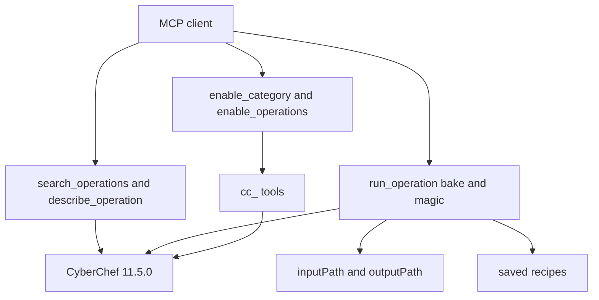

# CyberChef

Local [stdio](https://modelcontextprotocol.io) MCP server for [CyberChef](https://gchq.github.io/CyberChef) 11.5.0. The client keeps a small tool list. Every operation stays callable through `run_operation` and `bake`. A category, or a named list of operations, can be mounted as `cc_` tools for the rest of the session.



Node.js 24 or 25.

## Install

**Claude Code:**

```bash
claude mcp add cyberchef -- npx -y @zebbern/cyberchef
```

**Codex CLI:**

```bash
codex mcp add cyberchef -- npx -y @zebbern/cyberchef
```

**Any MCP client** (Claude Desktop, Cursor, Kimi, and others). Paste this next to the servers already in the file:

```json
"cyberchef": {
  "command": "npx",
  "args": ["-y", "@zebbern/cyberchef"]
}
```

This entry sets every variable. `CYBERCHEF_ALLOW_NETWORK` set to `false` keeps Networking operations listed and refuses to run them. The other three values are the defaults.

```json
"cyberchef": {
  "command": "npx",
  "args": ["-y", "@zebbern/cyberchef"],
  "env": {
    "CYBERCHEF_ALLOW_NETWORK": "false",
    "CYBERCHEF_TIMEOUT_MS": "30000",
    "CYBERCHEF_MAGIC_TIMEOUT_MS": "60000",
    "CYBERCHEF_RECIPE_PATH": "~/.cyberchef/recipes.json"
  }
}
```

## What it does

Fourteen tools stay registered. Argument schemas are in [docs/tools.json](docs/tools.json). All 539 operations and their arguments are in [docs/operations.json](docs/operations.json).

| Tool | Role |
| --- | --- |
| `list_categories` | Category names and operation counts. Matching ignores case. |
| `search_operations` | Full catalog, including operations the Node API cannot run. |
| `describe_operation` | Description, input type, output type, and arguments. |
| `run_operation` | One operation by name. |
| `bake` | A `{ op, args }` recipe, in order. |
| `magic` | Magic, with `depth`, `intensive`, `languageSupport`, and `crib`. |
| `save_recipe` / `load_recipe` | Store a named recipe and return it later. |
| `list_recipes` / `delete_recipe` | List saved names, or remove one. |
| `enable_category` / `disable_category` | Mount or unmount a category as `cc_` tools. |
| `enable_operations` / `disable_operations` | Mount or unmount named operations. |

`run_operation`, `bake`, and `magic` take `input` or `inputPath`, not both. `inputEncoding` is `utf8` (default), `base64`, or `hex`. `inputPath` is a file or a folder. A folder runs the same recipe on each file inside it, including nested files, up to 200 files. `outputPath` writes the raw bytes.

Encode `hello` through Base64, then Base62, then Base32:

```json
{
  "input": "hello",
  "recipe": [
    { "op": "To Base64" },
    { "op": "To Base62" },
    { "op": "To Base32" }
  ]
}
```

That bake returns `HBGG6TCUOE4XC22IOQ======`.

Saved recipes go to `~/.cyberchef/recipes.json`. `load_recipe` returns the step list. Pass that list to a later `bake`. Behavior, file rules, and the operations the Node API will not run are in [docs/reference.md](docs/reference.md).

## Configuration

Set these on the `env` object of the `cyberchef` entry. Unset means the default.

| Variable | Default | Effect |
| --- | --- | --- |
| `CYBERCHEF_ALLOW_NETWORK` | allowed | `false` keeps Networking operations in search and makes `run_operation` and `bake` refuse them. |
| `CYBERCHEF_TIMEOUT_MS` | `30000` | Time limit for `bake` and `run_operation`. The worker is terminated when it elapses. |
| `CYBERCHEF_MAGIC_TIMEOUT_MS` | `60000` | Time limit for `magic`. The worker is terminated when it elapses. |
| `CYBERCHEF_RECIPE_PATH` | `~/.cyberchef/recipes.json` | File used by the recipe tools. |

## Development

```bash
npm install
npm test
npm start
```

`npm install` downloads CyberChef 11.5.0 without running its Grunt postinstall, then applies the Node API patches. Do not install this package with `--ignore-scripts`.

To point a client at this folder before publish, use `node` as the command and `src/index.ts` in this folder as the argument. More detail is in [docs/development.md](docs/development.md).

## License

Apache-2.0. See [LICENSE](LICENSE). CyberChef is Crown copyright and is also Apache-2.0.
